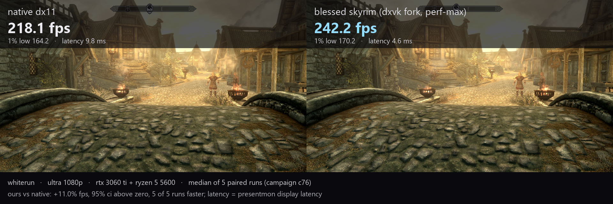

<picture> <source media="(prefers-color-scheme: dark)" srcset="docs/media/readme/header-dark.svg">  </picture>

      

`blessed skyrim` runs skyrim special edition through vulkan and beats the game's own native dx11. the goal was ultra settings at 1080p with no lag you would notice. this repo holds the skse plugin, the build scripts, the settings and the numbers.

the translation layer is **[blessed-dxvk](https://github.com/ble-ss/blessed-dxvk)**, a fork of dxvk 3.1.1 on the branch `blessed`. it gives most of the speed. the plugin adds the engine-side patches that a translation layer cannot reach.



## the numbers

all tests ran at ultra settings and 1080p on an rtx 3060 ti with a ryzen 5 5600. each result is the mean of paired differences against native dx11, with a 95% confidence interval. in each campaign, native and our fork take turns. the first repeat is thrown out as a warm-up.

| test | whiterun | flying the plains |
|---|---|---|
| perf-max vs native (c76) | **+10.97%** (+10.05 to +11.89), 5 of 5 | **+4.37%** (+3.70 to +5.03), 5 of 5 |
| the same, repeated (c80) | +12.09% (+11.12 to +13.07), 5 of 5 | +4.04% (+2.81 to +5.26), 5 of 5 |
| with display tweaks on both sides (c77) | +12.07% | +4.12% |
| with community shaders, engine fixes and display tweaks on both sides (c79) | **+16.64%** | **+6.05%** |
| our fork against stock dxvk 3.1.1 (c80) | 1.52x | 1.22x |

two caveats go with the table:

- **perf-max** refreshes slow effects (volumetric light, the far shadow cascade, the water reflection cube) every second or third frame while the camera holds still. what you see stays close to vanilla, though not identical. **strict** reproduces vanilla's exact image. it lands level with native in whiterun and about 5.5% behind in the flight.
- on display latency, presentmon puts us at 4.6 to 4.7 ms where native sits at 9.8 to 12.4 ms. the two backends start that clock at different points. treat it as a presentmon number until a camera test confirms it.

```
status:  perf-max ahead of native in both scenes. c76, repeated in c80.
strict:  level in whiterun. about 5.5% behind in the flight. open.
latency: lower on presentmon's clock. camera test next.
```

the writeups tell the full story, with the dead ends and the bugs that lied to us:

- [past native](https://bless.sh/nonfiction/blessed-skyrim/past-native/): how the fork got past native dx11.
- [ninety to one](https://bless.sh/nonfiction/blessed-skyrim/ninety-to-one/): the volumetric collapse. ninety compute dispatches fold into one, bit-identical.

to find the run behind any number, read [the tuning report](docs/tuning-report.md). the raw rows for every run are in [data/](data/README.md). each row names its campaign id, its settings and its result. it also lists the ideas that measured as nothing and the claims we corrected.

## what you need

- windows 10 or 11, skyrim special edition 1.7.104 and skse 2.3.1.
- an nvidia gpu.
- hardware-accelerated gpu scheduling (HAGS) turned on.
- the fork, from the `blessed` branch of blessed-dxvk.
- the plugin in `skse/skybench/` (this repo).

## settings

[docs/settings.md](docs/settings.md) lists the `dxvk.conf` keys, the `BLESSED_*` environment variables and the `skybench.ini` values.

the nvidia profile flag is easy to miss. in nvidia profile inspector, open the profile for `SkyrimSE.exe`. change the hidden setting "Vulkan/OpenGL Present Method - Flags" (`0x20324987`) to `0x00080104`. if you skip this step, dxvk uses the slow composed present path.

## building

1. to build the fork, run `tools/build-dxvk-mingw.cmd`. it uses llvm-mingw, which measured 3.4% faster than the same source built with msvc.
2. to build the plugin, run `tools/build-skybench.cmd`. it needs visual studio 2022 and cmake.

each script names the paths it expects at the top of the file: the dxvk checkout, the llvm-mingw toolchain and a few other tools. read them before the first run.

## the profiles

**perf-max** reuses slow effects across frames when the camera is steady. the image is not pixel-identical to vanilla. this profile gives the numbers in the table.

**strict** has no temporal reuse. it aims at vanilla's exact image. each change is bit-identical, or a named test checks it against vanilla. the gap in the flight is open. the cause we measured is the cost of handing a frame to the display, and it lands in a few passes of the next frame.

when we say "beat native", we mean perf-max.

## what is in here

| path | what |
|---|---|
| `skse/skybench/` | the skse plugin: scene loading, the cascade-walk skip, precipitation occlusion, the half-rate far cascade |
| `tools/build-dxvk-mingw.cmd` | builds the fork with llvm-mingw |
| `tools/build-dxvk.cmd` | builds the fork with msvc |
| `tools/build-skybench.cmd` | builds the plugin |
| `tools/build-win64-llvm-mingw-native.ini` | the meson native file for the llvm-mingw build |
| `docs/settings.md` | the dxvk.conf keys, environment variables, ini values and the nvidia flag |
| `docs/tuning-report.md` | the ledger of campaigns, settings and results |
| `docs/media/` | the figures from the writeups |
| `data/` | the raw results: `runs.csv` holds 2,370 runs (fps, lows, frame times, latency, gpu busy, pass or fail), `campaigns.json` holds 88 campaigns. [data/README.md](data/README.md) explains each column |

## license

mit, see [LICENSE](LICENSE). the vendored mimalloc copy in `skse/skybench/extern/mimalloc/` keeps its own license.

blessed-dxvk stays on dxvk's zlib license. the project stands on [dxvk](https://github.com/doitsujin/dxvk) by philip rebohle and contributors, and on [skse](https://skse.silverlock.org).
